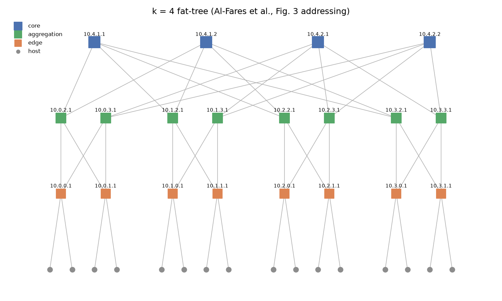
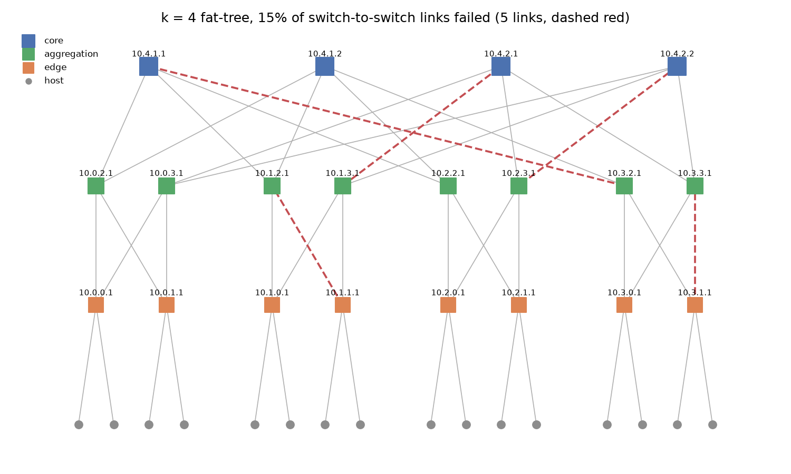
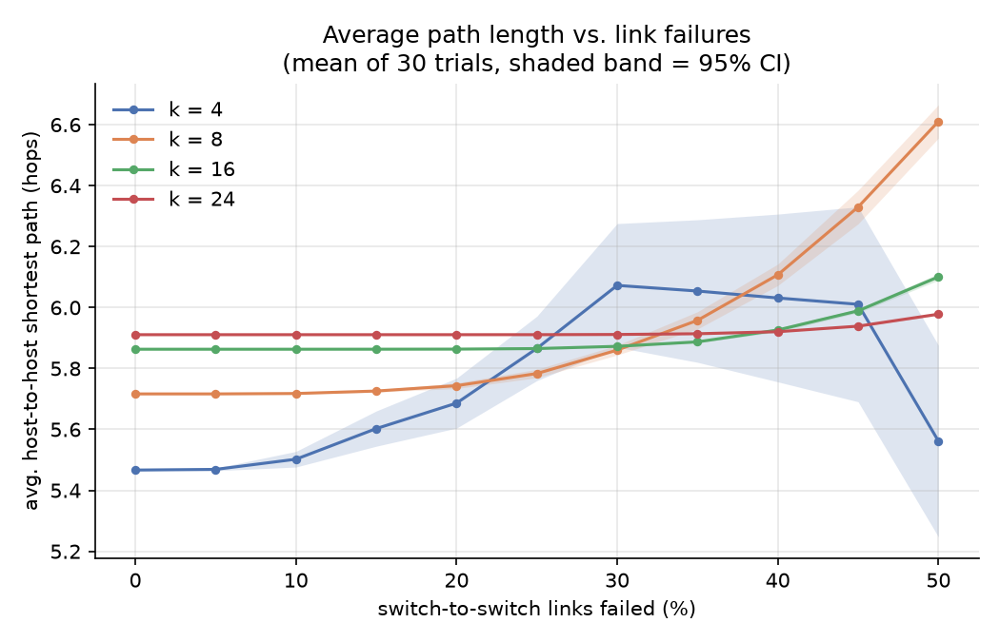
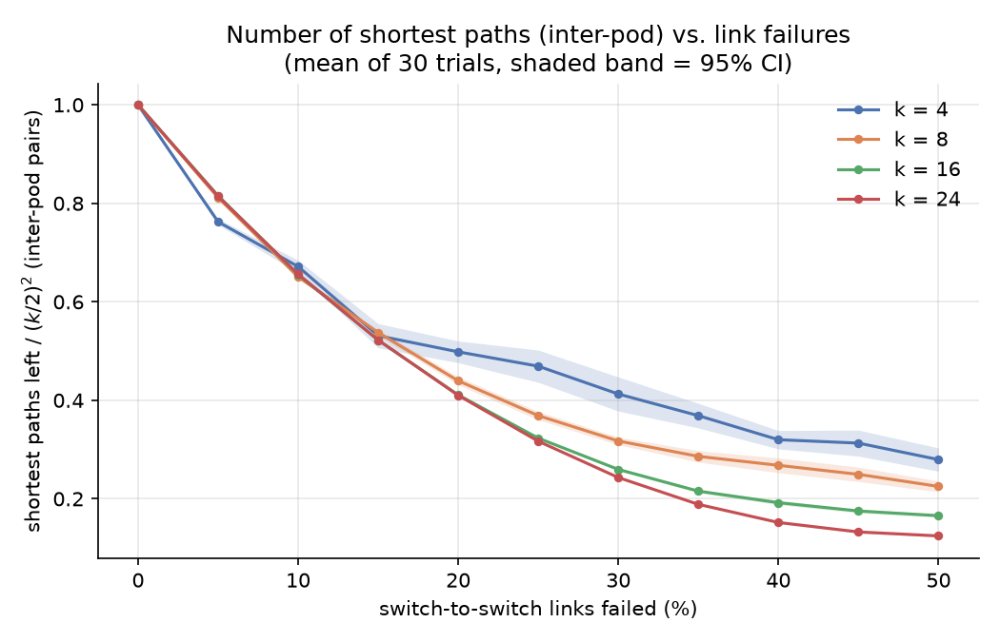
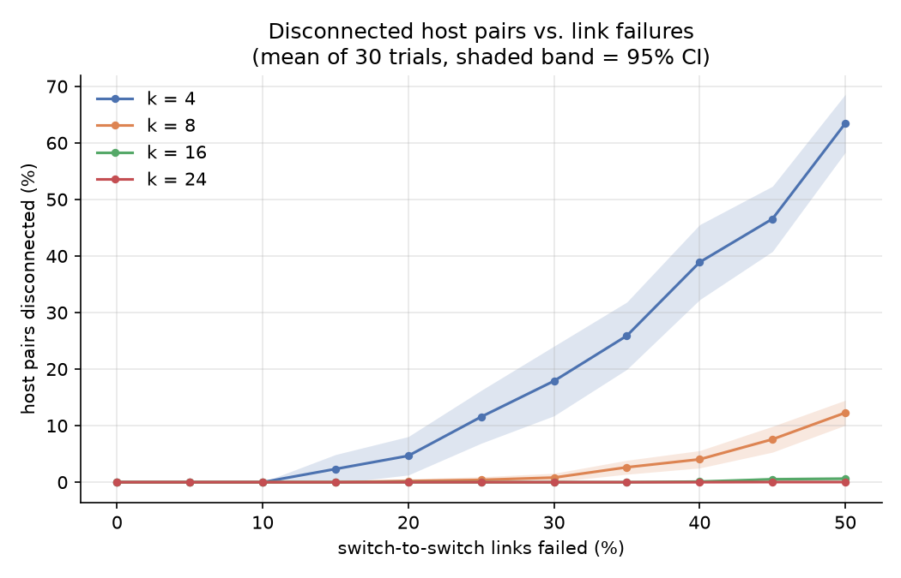

# Fat-Tree Network Topology: Generation and Failure Analysis

Homework 1, *Communication Networks for Data Centers and AI* (361.2.2460), Semester A 2026.

This repository generates the three-tier **k-ary fat-tree** from Al-Fares, Loukissas and Vahdat [1], randomly fails a chosen percentage of its links, and measures how the paths between hosts change.

**Question studied:** *As more links fail, how do the average path length and the number of shortest paths between hosts change, and how does the switch port count k affect this?*

**Short answer:**
- Hosts almost never lose connectivity, and paths barely get longer. At k = 24, with 30% of switch-to-switch links failed, every host can still reach every other host, and the average path is essentially unchanged.
- What the network *does* lose quickly is its **number of shortest paths**. With 10% of links failed, only about 65% of the shortest paths between pods remain.
- Larger k makes the network more robust.

---

## Repository layout

```
fattree/
  topology.py      k-ary fat-tree generator with the paper's 10.x.y.z addressing
  failures.py      random link-failure injection
  metrics.py       path length / number of shortest paths / disconnection over all host pairs
  visualize.py     drawing of the topology with failed links highlighted
  cli.py           command-line interface (python -m fattree)
experiments/
  run_experiments.py   reproduces every CSV and figure in results/
configs/example.json   example config file
tests/test_fattree.py  tests for the topology, failure model and metrics
results/               generated CSVs and PNGs
```

## Quick start

Requires Python 3.10 or newer.

```bash
python3 -m venv .venv && source .venv/bin/activate
pip install -r requirements.txt

python -m fattree -k 4 --metrics                                  # failure-free k=4 fat-tree
python -m fattree -k 8 -f 0.05 --seed 42 --metrics --draw k8.png   # 5% of links fail
python -m fattree --config configs/example.json                   # parameters from a config file
python -m fattree -k 16 -f 0.1 --failure-scope fabric --export topo.json

python experiments/run_experiments.py      # the full experiment (about 15 s on 8 cores)
pytest -q                                  # 29 tests
```

The program prints a JSON report. Example: `python -m fattree --config configs/example.json` (k = 8, 5% of switch-to-switch links failed, seed 42), abbreviated:

```json
{
  "expected": { "pods": 8, "hosts": 128, "edge_switches": 32, "aggregation_switches": 32, "core_switches": 16, "links": 384 },
  "topology": { "host_nodes": 128, "edge-aggregation_links": 117, "aggregation-core_links": 126, "links": 371 },
  "failures": { "failed_links": 13 },
  "metrics":  { "disconnected_pair_fraction": 0.0, "avg_path_length": 5.7165, "max_path_length": 6,
                "avg_shortest_paths": 11.72, "interpod_path_diversity": 0.807, "isolated_hosts": 0 }
}
```

## Topology design

The generator ([fattree/topology.py](fattree/topology.py)) follows Section 2.2 of [1]. Every switch has *k* ports, and k must be even:

| Element | Count | Connected to |
|---|---|---|
| Pods | k | each pod has an edge layer and an aggregation layer |
| Edge switches | k/2 per pod (k²/2 total) | k/2 hosts, and **every** aggregation switch in its pod |
| Aggregation switches | k/2 per pod (k²/2 total) | the k/2 edge switches below, and k/2 core switches above |
| Core switches | (k/2)² | one aggregation switch in each of the k pods |
| Hosts | k³/4 | one edge switch |
| Links | 3k³/4 | k³/4 host-edge + k³/4 edge-aggregation + k³/4 aggregation-core |

Every switch uses exactly k ports, so the whole network is built from identical cheap switches, which is the paper's main idea.

The core switches form a (k/2)×(k/2) grid. Aggregation switch number *j* in every pod connects to all core switches in row *j* of the grid, following the paper's wiring rule.

Nodes are named with the paper's IP addresses (Section 3.2, Fig. 3):

- **Edge and aggregation switches:** `10.pod.switch.1`. Edge switches are numbered 0 to k/2-1 and aggregation switches k/2 to k-1.
- **Core switches:** `10.k.j.i`, where (j, i) is the switch's position in the core grid.
- **Hosts:** `10.pod.switch.ID`, with ID from 2 to k/2+1.



The figure shows the generated k = 4 fat-tree. Its labels match Figure 3 of [1].

## Input specification

Every parameter can be given on the command line, in a JSON `--config` file, or both. Command-line values override the file.

| Parameter (CLI / config key) | Type | Default | Meaning |
|---|---|---|---|
| `-k`, `--k` / `k` | even int, 2 ≤ k < 256 | 4 | Switch port count. It sets the network size: k pods, 5k²/4 switches, k³/4 hosts. The limit of 256 comes from the addressing scheme, which uses one byte per field. |
| `-f`, `--failure-rate` / `failure_rate` | float in [0, 1] | 0 | Fraction of links that fail. |
| `--failure-scope` / `failure_scope` | `all` \| `fabric` | `all` | `all`: any link can fail. `fabric`: only switch-to-switch links can fail. |
| `--failure-mode` / `failure_mode` | `exact` \| `bernoulli` | `exact` | `exact`: exactly that fraction of links fails, chosen at random. `bernoulli`: each link fails independently with that probability. |
| `--seed` / `seed` | int | none | Random seed, so a run can be repeated exactly. |
| `--metrics` / `metrics` | flag | off | Compute the path metrics below. |
| `--export PATH` / `export` | path | none | Save the topology after failures as JSON, including the list of failed links. |
| `--draw PATH` / `draw` | path | none | Save a picture of the topology. Readable up to about k = 8. |

Invalid input (odd k, k ≥ 256, a rate outside [0, 1], unknown config keys) is rejected with an error message.

## Failure model

A failed link is removed from the graph, and the switches at both of its ends keep working. [fattree/failures.py](fattree/failures.py) picks the failed links at random.

## Metrics

[fattree/metrics.py](fattree/metrics.py) computes these over **all** pairs of hosts:

| Metric | Meaning |
|---|---|
| **Average path length** (`avg_path_length`) | Average number of links (hops) on the shortest path between two hosts. Without failures, a path is 2 hops between hosts on the same edge switch, 4 hops within a pod, and 6 hops between pods. |
| **Number of shortest paths** (`interpod_path_diversity`) | How many different shortest paths connect two hosts in different pods, divided by the (k/2)² paths a healthy fat-tree provides [1, §3.1]. 1.0 means all paths are still there. These parallel paths are what the paper's routing spreads traffic over. |
| **Disconnected host pairs** (`disconnected_pair_fraction`) | Share of host pairs with no path between them at all. |

The path length and the number of shortest paths are averaged over the host pairs that are still connected.

**How it is computed.** Every host has a single link to one edge switch. So the path between two hosts is the path between their edge switches, plus one hop at each end. The code runs a breadth-first search (BFS) from each edge switch, which finds both the distance and the number of shortest paths to every other switch. This is fast: all 6 million host pairs of a k = 24 network take well under a second. The tests compare the results with the `networkx` library's own shortest-path functions on small networks.

## Results

### Setup

- **Port counts:** k = 4, 8, 16 and 24, which is 16, 128, 1,024 and 3,456 hosts.
- **Failure rates:** 0% to 50% of the switch-to-switch links, in steps of 5%. Host-to-switch links do not fail in this experiment: a host with a failed link is simply cut off, which tells us nothing about the fat-tree itself.
- **Trials:** each point is the average of **30** random failure patterns. The shaded bands in the plots are 95% confidence intervals.

Run it with `python experiments/run_experiments.py`. Per-trial results are in [results/failure_sweep_raw.csv](results/failure_sweep_raw.csv) and averages in [results/failure_sweep_summary.csv](results/failure_sweep_summary.csv).



*Example of one failure pattern: k = 4 with 15% of the 32 switch-to-switch links failed (5 links, dashed red).*

### 1. Average path length



**Observations:**
- **Starting points differ by k.** Without failures, the averages are 5.47, 5.72, 5.86 and 5.91 hops for k = 4, 8, 16 and 24. Larger networks have a larger share of host pairs in different pods (6 hops), so the average gets closer to 6.
- **Large networks are barely affected.** At k = 24 the average stays at 5.91 hops up to 30% failures and reaches only 5.98 at 50%.
- **Why paths get longer at all.** Most failures remove one of several equivalent paths, and another path of the same length takes over. A path gets longer only when every short route is broken. For example, a switch's only working uplink may lead to an aggregation switch that has lost all its core links. Traffic must then take a detour of 8 hops instead of 6. This happens much more often in small networks, which have fewer alternatives. At k = 8, the average reaches 6.61 hops at 50% failures.
- **Why k = 4 drops after 30%.** The average only counts pairs that are still connected. At high failure rates in a k = 4 network, distant pairs are disconnected first (see plot 3). The pairs that remain are mostly nearby, short-path pairs, which pulls the average down. The drop does not mean the network got better.

### 2. Number of shortest paths



| links failed | k = 4 | k = 8 | k = 16 | k = 24 |
|---|---|---|---|---|
| 10% | 67% | 65% | 66% | 66% |
| 20% | 50% | 44% | 41% | 41% |
| 30% | 41% | 32% | 26% | 24% |

**Observations:**
- **This metric drops fast, even while hosts stay connected.** At 10% failures about a third of the shortest paths between pods are already gone, for every k.
- **Simple explanation.** A shortest path between pods uses 4 switch-to-switch links (edge→aggregation→core→aggregation→edge). The path survives only if all 4 links survive. With 10% of links failed, that is about 0.9⁴ ≈ 0.66, which matches the measurements.
- **Small networks look better above 20%, but only on paper.** The average only counts connected pairs, and after all 6-hop paths of a pair break, its 8-hop detour paths are counted instead. So the small-k curves stay higher.
- **Significance.** The paper's routing spreads traffic evenly over these parallel paths to give every host full bandwidth [1, §3]. Fewer paths means less total capacity between pods. So link failures first reduce **performance**, long before they break **connectivity**.

### 3. Disconnected host pairs



| links failed | k = 4 | k = 8 | k = 16 | k = 24 |
|---|---|---|---|---|
| 10% | 0.0% | 0.0% | 0.0% | 0.0% |
| 30% | 17.9% | 0.8% | 0.0% | 0.0% |
| 50% | 63.4% | 12.3% | 0.6% | 0.02% |

**Observations:**
- **Larger k is much more robust.** Every edge switch has k/2 links up to the aggregation layer, and every aggregation switch has k/2 links to the core. To disconnect two hosts, *all* of these alternatives must fail. With k = 4 there are only 2 of each, so 30% failures already cut off 18% of host pairs. With k = 24 there are 12 of each, so even 50% failures disconnect almost nothing.
- **Significance.** The fat-tree's built-in redundancy protects connectivity very well. Its weak points are elsewhere: the number of usable paths (plot 2), and each host's single link to its edge switch, which this experiment does not fail.

### Summary

As links fail, a fat-tree first loses **capacity** (fewer parallel shortest paths). Only at much higher failure rates does it lose **path length** or **connectivity**. A larger port count k makes connectivity and path length more resilient. However, the share of shortest paths lost is about the same for every k, because each path still needs 4 links to survive.

## Testing

`pytest -q` runs 29 tests:

- **Topology:** element counts for several k, exactly k ports per switch, each core switch connected once to every pod, the paper's Figure 3 addresses, and rejection of invalid k.
- **Failure model:** the number of failed links, which links can fail, and that the same seed gives the same failures.
- **Metrics:** correct values for a healthy network (compared with formulas), the same results as `networkx` on networks with failures, and a hand-built case that forces an 8-hop detour.
- **Command line:** config file loading and command-line overrides.

## AI usage

This project was developed with the help of **Claude (Anthropic), via Claude Code**, used as a coding assistant to:

- set up the package structure,
- write the generator, metrics, experiment and test code from the specification in [1] and the assignment,
- draft this README.

The author reviewed the design decisions, the choice of metrics and the interpretation of the results. The test suite checks the code's correctness.

## References

[1] M. Al-Fares, A. Loukissas, and A. Vahdat, "A scalable, commodity data center network architecture," *SIGCOMM Comput. Commun. Rev.*, vol. 38, no. 4, pp. 63–74, Oct. 2008, doi: [10.1145/1402946.1402967](https://doi.org/10.1145/1402946.1402967).
